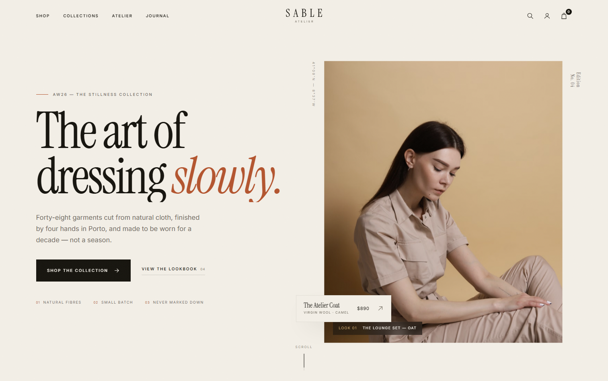

# SABLE — Atelier



A quiet-luxury e-commerce storefront for a fictional Porto atelier. Forty-eight fixed pieces, released slowly.

Zero build step — plain HTML, CSS and vanilla JavaScript. Open the file or serve the folder.

## Run it

```bash
# any static server works
npx serve .
# or
python -m http.server 4322
```

Then open `http://localhost:4322`.

You can also open `index.html` directly in a browser; every asset is either inline or loaded from a CDN.

## What's inside

- **Hero** — curtain reveal, slow parallax, floating product tag, vertical edition mark
- **New Arrivals** — 10 products, category filters with a sliding pill, two editorial filler tiles that balance the grid
- **Bag** — add, increment, remove, subtotal, free-shipping meter, persisted in `localStorage` (checkout is an explicit demo)
- **Search** — full-screen overlay, live filtering, jumps to the matching card
- **Lookbook** — full-screen viewer with preload, prev/next, arrow keys, Escape
- **Anatomy of the Atelier Coat** — interactive isometric plate: hover a layer for its spec, tilt with the pointer, take the coat apart
- **Story / Collections / Press / Newsletter / Footer** — editorial sections with reveal choreography and a live Porto clock

## Structure

```
index.html   markup, including the inline SVG anatomy figure
styles.css   design system, layout, responsive breakpoints, reduced motion
app.js       all behaviour (cart, search, lookbook, filters, figure, nav)
```

## Notes

- Animation is transform/opacity only, easing is shared, and `prefers-reduced-motion` disables the choreography.
- Product photography is hotlinked from [Pexels](https://www.pexels.com) for demonstration. Replace with your own shots before going live.
- Fonts: Instrument Serif and Inter via Google Fonts.
- Design and build follow the `motion`, `motion-design` and `anatomy` skills (Motion/Framer principles applied to CSS + vanilla JS).
